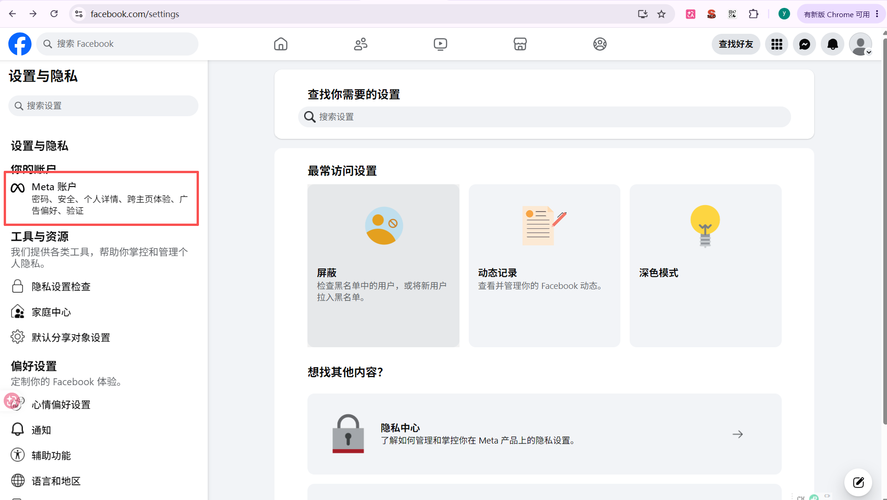
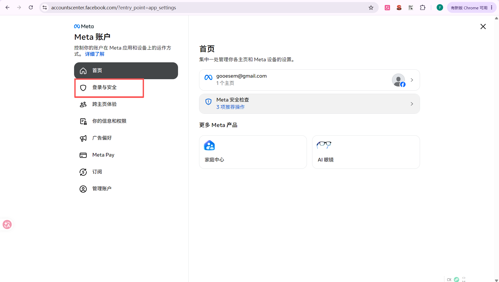
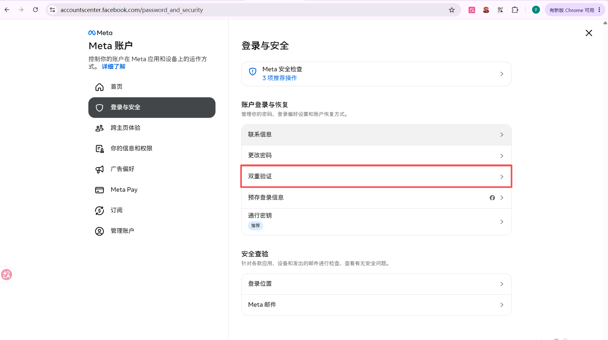

注册完成后务必查看[00 注意事项](00%20%E6%B3%A8%E6%84%8F%E4%BA%8B%E9%A1%B9.md)

# 个人主页注册教程

在地址栏输入【https://www.facebook.com/】，进入[facebook官网](https://www.facebook.com/)
点击【创建新账号】

## 根据页面提示填写相关信息注册
>使用手机号码注册时,号码前需加国家区号+86或0086
>使用邮箱注册时，推荐使用谷歌邮箱

填完后点击【提交】

根据页面提示操作
- 手机号码注册填写手机收到的验证码
	- 如果收不到验证码，请在手机设置中打开**漫游设置**
- 邮箱注册填写邮箱收到的验证码

## 进入FACEBOOK页面
>输入验证码后即可进入facebook

# 安装身份验证器

## 安装【身份验证器】插件
1. 打开网址【https://chromewebstore.google.com/category/extensions】进入[chrome应用商店](https://chromewebstore.google.com/category/extensions)
2. 在搜索框输入【身份验证器】，并搜索
3. 点击第一个身份验证器
4. 点击 【添加至Chorme】
	1. 
## 打开双重验证
## 进入设置
1. 第一步点击 头像
2. 第二步点击 【设置与隐私】
	1. 
3. 第三步点击 【设置】
	1. 
	2. 显示以下页面即成功进入设置
		1. 
## 进入账户中心
1. 进入设置后点击【meta账户】进入账户中心
	1. 

2. 进入账户中心后点击【登录与安全】
	- 
3. 点击【双重验证】
	- 
4. 点击【开始】
	1. 
	2. 按照指示输入账户密码
5. 选择【身份验证应用】，然后点击【继续】
	1. 
6. 添加账号
	1. 
	2. 
7. 输入验证码后即完成双重验证设置

