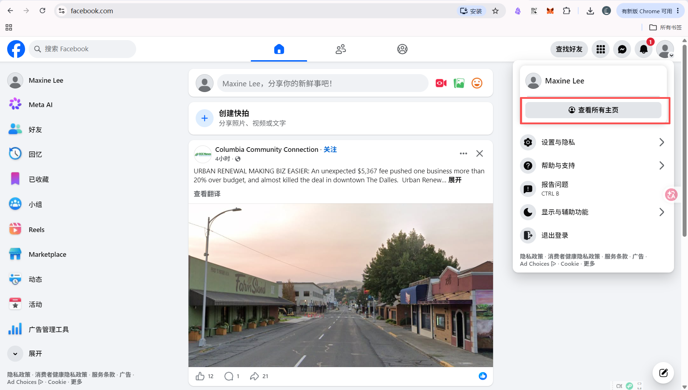
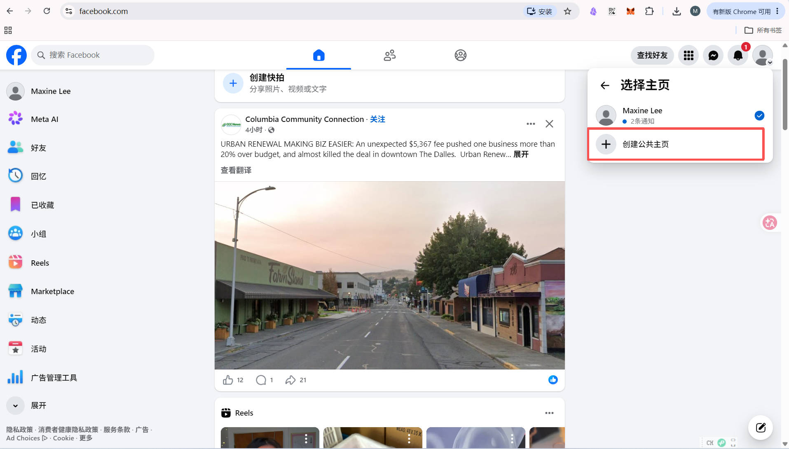
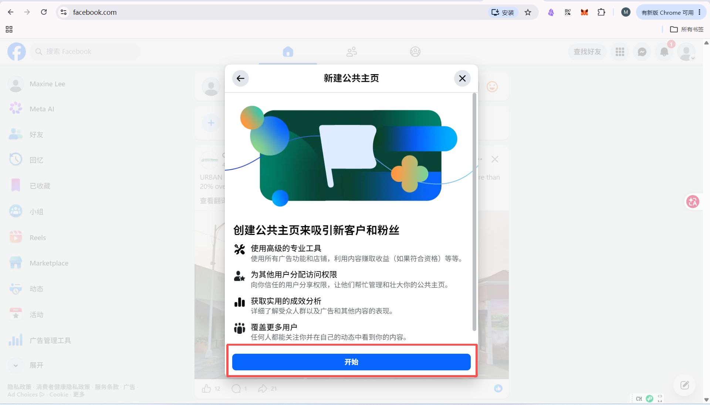

> 本教程适用于已经完成 Facebook 个人账号注册和双重验证，需要为贵司创建品牌公共主页的账号负责人。建议使用电脑操作。本文中的称呼沿用 [总说明](README.md#称呼说明)。

Facebook 个人账号用于登录和管理；Facebook 公共主页用于向访客和潜在买家展示贵司、产品和内容。访客看到的是公共主页，不会因此获得您个人账号的登录信息。[个人主页和公共主页的区别](FAQ.md)

## 创建前准备
请先准备以下内容：
- 企业或品牌的英文名称；
- 最能代表主营业务的行业类别；
- 一句简短的英文业务介绍。

主页名称建议与官网、商标和其他社媒平台保持一致。不要加入不属于品牌名称的宣传词、符号或联系方式，以免影响审核和潜在买家识别品牌。

## 第一步：进入公共主页创建页面

1. 登录您的 Facebook 个人账号。[注册教程](00%20facebook注册.md#个人主页注册教程)
2. 点击右上角头像
	1. 
3. 再点击“查看所有个人主页 / See all profiles”。
	1. 
4. 点击“创建新公共主页 / Create new Page”。
	1. 
5. 选择“公共主页”后，点击“下一步”
	1. 
6. 点击“开始”
	1. 

## 第二步：填写公共主页信息
请依次填写主页名称、类别和简介。
1. 填写主页名称
	1. 在“公共主页名称 / Page name”中输入企业或品牌名称。
2. 选择类别
	1. 点击“类别 / Category”。
	2. 输入与主营业务相关的英文关键词。
	3. 从 Facebook 提供的选项中选择最接近企业实际业务的类别。
3. 填写简介
	1. 在“简介 / Bio”中，用一句英文说明贵司做什么、服务哪些目标买家。

### 公共主页名称(Name)
**要求**：必须准确代表主页内容。不能包含误导性词汇、过多的标点符号或全大写字母（除非是缩写）。
- **禁止包含的内容**：
	- **误用品牌词**：不能包含“Facebook”、“Meta”或任何 Meta 公司产品的名称及其变体。
	- **误导性词汇**：如果该主页不是品牌的官方代表，不能在名称中使用“官方”（Official）一词。
	- **描述性内容**：名称中不能包含口号或详细描述（例如：不能写成“XX咖啡
	- 全城最好喝的咖啡”），此类信息应放在“关于”部分。
	- **符号限制**：禁止使用特殊符号（如 ®）或不必要的标点符号。
- **命名格式限制**：
	- **禁止全大写**：除缩写外，不能全部使用大写字母。
	- **禁止不规范大小写**：不能使用不符合语法的大小写（例如：tHe bEsT cAfE）。
	- **避免过于宽泛**：不能仅由一个通用词（如“Pizza”）或一个通用地理位置（如“New York”）组成。
**填写建议**：建议使用“**品牌名”。
- 例如：*Gooe Yun*
- 这样可以让潜在买家在搜索产品时更容易发现您，并一眼看出您的身份
### 公共主页类别(Catagory)
**要求**：最多可以选择 3 个类别。
**填写建议**：第一个类别最为重要，它会显示在主页名称下方并影响推荐算法。
- 厂家推荐选择：**厂家 (Manufacturer)**、**工业公司 (Industrial Company)** 或**批发商 (Wholesaler)**。
- 请确保类别与您的实际业务高度相关，这有助于买家通过分类搜索找到您。
### 个性签名(bio)
**要求**：限 255 个字符以内。
**填写建议**：这是买家进入主页后看到的简短介绍，应包含您的**核心价值点**。
- 模板：*专注于【产品领域】的生产厂家，拥有【X】年行业经验。提供 OEM/ODM 服务，欢迎询盘获取目录。*
- 突出您的工厂优势（如：研发实力、证书认证、出口经验）。
- 

## 第三步：完成公共主页设置

为了让主页看起来更专业并提高可见度，建议完成以下核心设置：
1. **个人资料照片**（Profile Picture）
	- **建议尺寸**：最佳上传尺寸为 **320 x 320 像素**。
	- **显示尺寸**：在电脑端显示为 176x176 像素，在智能手机上显示为 196x196 像素。
	- **裁剪方式**：虽然上传的是方形图片，但 Facebook 会将其**裁剪为圆形**。因此，请确保重要的文字或 Logo 位于图片的正中心，以免被切掉。
	- **文件格式**：如果包含 Logo 或文字，建议使用 **PNG** 格式以获得更清晰的效果。
2. **封面照片**（Cover Photo）。
	- **建议尺寸**：最佳上传尺寸为 **851 x 315 像素**。
	- **显示比例差异**：
		- **电脑端**：以 16:9 的比例显示。
		- **移动端**：以 2.4:1 的比例显示。
		- **安全区域**：由于电脑和手机的显示比例不同，建议将重要的视觉元素（如联系方式、Slogan）放在**图片的中心区域**。
		- *注意*：在手机端，头像会遮挡封面图左侧约 40 像素的区域。**考虑头像在左侧的遮挡情况，避免在左下角放置关键信息**
	- **文件限制**：建议使用 **sRGB JPG** 格式，文件大小控制在 **100 KB 以下** 以加快加载速度。同样地，若有文字或 Logo，建议使用 **PNG** 格式。
	- **最低限制**：图片宽度至少需达到 400 像素，高度至少需达到 150 像素。
3. **网站**：添加您的官方网站链接。
4. **联系信息**：填写电子邮箱、电话号码。
5. 填写完信息后点击“完成”
	1. 

完成后自动跳转到 管理公共主页 页面，点击“编辑”可调整刚刚的公共主页设置
