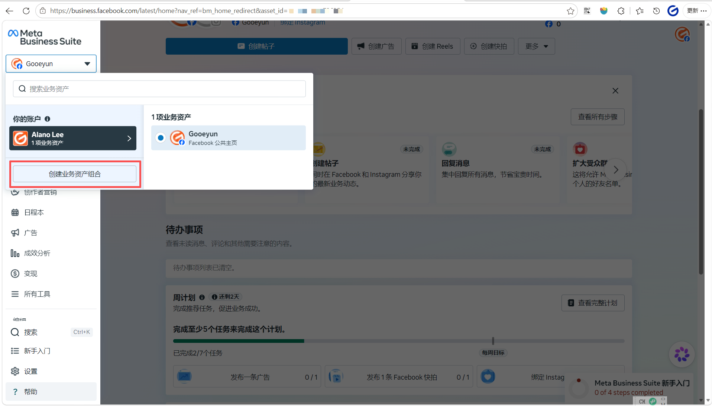

# 介绍
业务资产组合（Business Portfolio）就是您在Meta上的“公司总后台”，用来把您所有的业务资产和人员权限集中在一个地方统一管理。

简单理解：
- 业务资产组合 = 房子，
- 公共主页/广告账户/Pixel = 家具，
- 员工/客户 = 住在房子里的人。
先建好房子，再把家具和人放进去，管理最清晰，也最不容易出现资产归属纠纷。

 [业务资产组合是什么](FAQ.md#业务资产组合是什么)
[业务资产组合包括哪些东西](FAQ.md#业务资产组合包括哪些东西)

---
# 步骤
## **第一步：准备工作**
- **账号要求**：使用已注册超过14天、每天正常使用、无异常提示的Facebook个人账号登录。不要用新号当天就创建。
- **准备信息**：
	- **名称**：使用公司对外的公开名称，不要包含特殊符号如 @ # $ %，且创建后修改很麻烦。每个人一生最多只能亲自创建2个组合，所以名称要一次想好。
	- **邮箱**：填写真实、常用的公司邮箱，用于接收验证邮件。这个邮箱不会对外公开，但Meta会用它联系您。验证邮件有时在垃圾箱，请及时查收并点击验证。
- 您必须有权使用 Facebook 个人主页或受管理 Meta 账户访问 Meta Business Suite。

## **第二步：进入创建页面**
- 在电脑浏览器中打开 [business.facebook.com](https://business.facebook.com/)
- 点击右上角 **登录**，使用您的Facebook个人账号和密码登录
- 登录成功后，您会进入Meta Business Suite主页

## **第三步：创建业务资产组合**
- 在页面左上角，点击“主页头像或者名字”
	- 
- 点击该下拉菜单，在弹出的列表最下方点击 **“创建业务资产组合”**
	- 

## 输入业务资产组合信息
- 在弹窗中输入 **业务资产组合名称**，例如 `YourCompany Ltd`
	- 建议使用您公司的正式公开名称。这有助于 Meta 验证您的业务身份，也方便您在管理多个资产时进行识别。
	- 名称中不能包含特殊字符，例如 @、#、$、%、* 等。
	- 请勿使用误导性的名称或他人已注册的商标名称，以免触发系统审核或导致账户受限。
	- 虽然没有极其严格的字数限制，但建议保持简短清晰，方便在 Meta Business Suite 的下拉菜单中查看。
	- [业务资产组合名称不通过怎么办？](FAQ.md#如果业务资产组合名称不通过怎么办)
- 输入您的 **姓名** 和 **公司邮箱**，然后点击 **创建** 或 **创建资产组合**
	- 姓名必须使用您的真实姓名，即身份证或护照上的名字
		- **身份验证**：如果您的账户因安全原因被锁定或需要进行业务验证，Meta 会要求您上传政府签发的身份证件。如果系统记录的姓名与证件不符，您可能无法找回账户或通过验证。
		- **账户安全**：使用真实姓名有助于防止虚假账户和欺诈行为，保护您的业务资产安全。

## 验证邮箱
- 系统会立即向您填写的公司邮箱发送一封验证邮件，前往您的邮箱点击**”立即验证“** 完成验证。如果没收到，请检查垃圾邮件箱
	- 该邮箱必须**真实有效**，因为 Meta 会向其发送验证邮件。如果您无法完成邮箱验证，业务资产组合的功能将受到限制。
	- 

### 可选可添加已有的资产

## **第四步：验证创建成功**
- 验证邮箱后，刷新 [business.facebook.com](https://business.facebook.com/) 页面
- 再次点击左上角下拉菜单，您就能看到新创建的业务资产组合名称，说明创建成功

- 您现在就是这个组合的管理员，拥有完全控制权。[业务资产组有哪几种权限，分别有什么权利？](FAQ.md#业务资产组有哪几种权限分别有什么权利)

# **重要规则提醒**
## **数量限制**
- 每个人最多只能亲自创建2个业务资产组合，但可以被邀请加入无数个组合，所以名称要慎重。

## **资产只能属于1个组合**
- 一个公共主页、广告账户、Pixel像素代码只能归属于1个业务资产组合，不能同时属于两个。创建前就要规划好：这个主页/广告账户是属于您自己公司，还是属于客户公司。放错了后期转移非常麻烦。
    

## **新组合功能会受限是正常的**
- 为了防止滥用，新创建的业务资产组合或广告账户，暂时无法使用所有广告功能。这是平台的安全保护，不是您的操作问题。
- 您可以在 [Business Support Home](https://business.facebook.com/support) 查看当前可用的功能，随着您正常使用，权限会逐步开放。
    

## **创建后不要马上投广告**
- 创建成功后，先在组合内创建公共主页和广告账户，完善主页信息、绑定支付方式、安装Pixel。不要创建完立刻就开广告，同样会被风控。
    

## **开启双重验证，保护资产安全**
- 创建后，立即为您的个人账号和业务资产组合开启双重验证（2FA），并添加至少2个管理员。防止一个管理员账号被封导致整个组合无法访问。