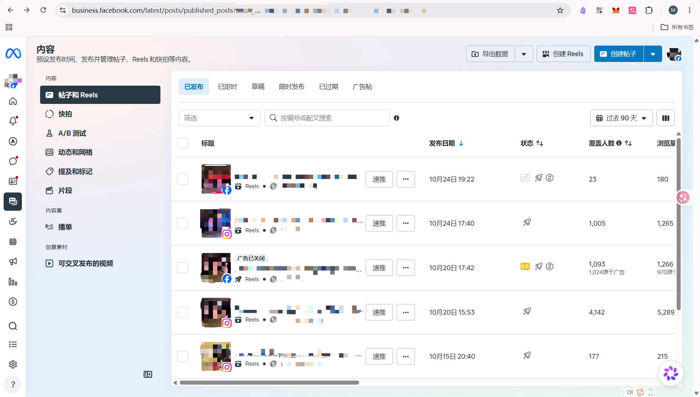

> 建议使用电脑操作。适用于贵司已创建 Meta 业务资产组合，并要邀请协作人员管理 Facebook 公共主页、Instagram 账号或广告账户的情况。本文中的称呼沿用 [总说明](README.md#称呼说明)。正式发布前，应按贵司实际界面补齐截图；Meta 的按钮名称可能随语言和版本变化。

# 操作前准备
1. 请确认您登录的是**拥有业务资产组合完整控制权**的账号。只有具备该权限的人才能邀请人员。
2. 向受邀的协作人员确认其 Facebook 账号使用的邮箱，并提前确定其工作职责：发帖、回复消息、看数据或管理广告。
3. 确认要交给协作人员管理的公共主页、Instagram 账号或广告账户，已经出现在该业务资产组合中。

> **权限原则**：业务资产组合权限决定协作人员能否管理整个业务；资产权限决定协作人员能对某个主页、Instagram 账号或广告账户做什么。一般运营人员只需获得完成工作所需的权限，不要随意开启“完整控制权”。贵司应保留完整控制权。

# 业务资产组合授权
## 第一步：进入业务资产组合设置

1. 打开 [Meta Business Suite](https://business.facebook.com/) 并登录。
2. 如果您管理多个业务资产组合，先确认左上角显示的是**本次要授权的企业名称**。
3. 点击左侧“设置 / Settings”，进入该业务资产组合的设置页面。

## 第二步：发起人员邀请

1. 在设置页左侧找到“用户 / Users”下的“人员 / People”。
2. 点击右上角“邀请人员 / Invite people”。

3. 输入邮箱：输入受邀人的邮箱，检查拼写无误后点击“下一步”。
	- 使用个人 Facebook 账号接受邀请时，邮箱应与该 Facebook 账号使用的邮箱一致。
	- [业务资产组合的 临时访问权限是什么？](FAQ.md#业务资产组合的-临时访问权限是什么)

4. 授予访问权限：选择合适的权限后，点击”下一页“
	1. [完全访问权限和部分访问权限有什么区别？](FAQ.md#业务资产组有哪几种权限分别有什么权利)
	2. 
5. 分配资产：
	1. 点击”倒三角“，在资产列表中勾选需要交给协作人员的 Facebook 公共主页、Instagram 账号或广告账户。，然后点击”确认选择“
		1. 
	2. 对每项资产分别选择协作人员需要的操作权限，然后点击”下一页“
		1. 
	3. 审核：在最终确认页再次核对：**邮箱、业务资产组合权限、资产名称、各资产权限**。确认信息无误后，点击”使用1项资产邀请“
		1. 

# 业务资产组合的接收
## 受邀人接受邀请

### 找到邮件
1. 请受邀人查看对应邮箱中的 Meta 邀请邮件，也检查==**社交**==邮件文件夹。

2. 由受邀人本人点击邮件中的“登录以查看邀请”

### 登录账号
1. 登录自己的 Facebook 账号：点击“用Facebook继续”

2. 填入名、姓(比如：名Alano 姓Liu)，然后点击“继续”
这个名字主要用于**内部协作和管理**。它能帮助管理员和其他同事知道是谁在操作特定的广告资产或进行设置。
**名字会显示在哪里？**
- **用户列表**：在业务设置的“人员”选项卡中，管理员会看到这个名字。
- **操作记录**：如果您对广告、公共主页或像素进行了更改，系统在记录这些操作历史时会显示您的名字。
- **资产分配**：当管理员为您分配公共主页或广告账户权限时，会通过这个名字来识别您。

2. 点击“继续”

3. 核对姓名和邮箱后点击“接受邀请”，输入账号密码后即完成

4. 输入账号密码，再点击“提交”，

5. 受邀人实际进入已分配的主页或 Instagram 账号，测试是否能完成约定工作，例如查看内容、发帖或回复消息。
