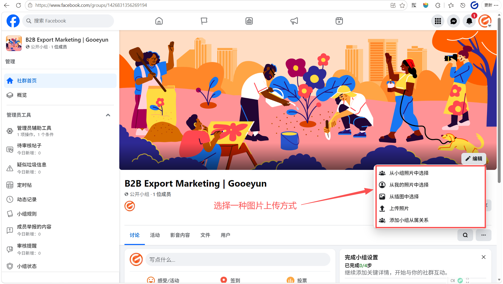

# intro
## Facebook 小组是什么
Facebook 小组（Groups）是一个让具有共同兴趣的人们聚集在一起交流、分享和讨论特定话题的平台。对于 B2B 企业而言，小组是建立行业社群、展示专业知识并与潜在客户进行深度互动的核心空间。
## Facebook 小组的主要特点和对 B2B 企业的价值
**1. 建立深度连接的社区**
- **互动的中心**：与公共主页（Page）主要由官方发布信息不同，社群更强调成员之间的双向讨论。买家可以在这里提问，而您可以作为专家提供解答。
- **信任的孵化器**：在 B2B 贸易中，信任至关重要。社群提供了一个非正式的场景，让潜在客户通过长期的内容分享和互动，对您的工厂和产品产生深度认可。
- **精准的聚集地**：社群通常围绕特定主题建立（如“全球紧固件采购”或“注塑模具技术交流”），加入成员的意向通常比普通浏览者更精准。
**2. 灵活的隐私设置**
- **公开社群 (Public)**：任何人都能在 Facebook 搜索到该社群，并看到其中的成员和帖子。这非常适合 B2B 企业初期吸引流量和扩大知名度。
- **私密社群 (Private)**：只有成员才能看到帖子内容。您可以设置为“可见”（所有人都能搜到但需申请加入）或“隐藏”（只有受邀者能找到）。这适合作为您的 VIP 客户服务群或核心代理商交流群。
**3. 强大的管理工具**
- **以主页身份加入**：您可以指导客户[以公共主页身份创建或加入小组](https://www.facebook.com/business/help/2167010730015450)，从而统一品牌形象。
- **入群审核**：通过设置入群问题，企业可以筛选掉无关人员，确保社群成员都是高质量的潜在客户或合作伙伴。
**4. 数据洞察**
- **小组成效分析**：如果小组人数超过 50 人，管理员可以查看成员活跃度、热门帖子等数据，帮助优化运营策略。
## 公共主页与小组的区别
公共主页（Page）是您企业的官方“门面”，而社群（Groups）则是您与客户互动的“客厅”。在 B2B 业务中，公共主页用于建立品牌形象和发布官方公告，社群则用于深度交流和客户留存。

|维度|公共主页（Page）|社群（Groups）|
|---|---|---|
|定位|企业的官方身份，类似于官网。|兴趣或行业交流中心，类似于论坛。|
|互动方式|以单向发布为主，粉丝评论为辅。|以双向讨论为主，鼓励成员之间相互交流。|
|可见性|默认公开，所有人都能搜索并查看。|可选择公开或私密，能够控制内容的可见范围。|
|主要功能|运行广告、展示产品、查看成效分析。|开展深度问答、建立信任、沉淀核心客户。|
|受众关系|关注者（粉丝），关系相对疏远。|成员，关系更紧密，参与度更高。|

## 什么企业适合建立小组
- **产品具有技术门槛**：如果您的产品（如工业机械、精密仪器、新型材料）需要专业的操作指导或技术支持，社群可以作为您提供售后服务和技术交流的中心。
- **交易决策周期长**：B2B 业务通常涉及大额订单，买家需要长期观察。社群能让潜在客户在下单前通过观察您与其他成员的互动，建立对您工厂实力的信任。
- **行业有持续讨论的话题**：如果您的行业有频繁的行情波动、技术更新或政策变化（如光伏能源、跨境物流、电子元器件），建立一个行业资讯分享群能吸引大量精准买家。
- **拥有核心代理商或分销商**：您可以建立私密社群，专门用于管理海外代理商，发布最新的产品报价、促销政策和培训资料。
- **追求高客户留存率**：如果您希望客户不仅是“一锤子买卖”，而是成为品牌的忠实拥护者，社群是沉淀这些老客户的最佳场所。
## 哪些情况下不建议建立
- **缺乏专人维护和互动**：社群的核心在于“活”。如果您无法保证每周至少有 2-3 次的互动回复或内容更新，社群会迅速变成“死群”或充斥着垃圾广告的场所，这会让潜在买家对您的专业性产生怀疑。
- **产品极度标准化且无须交流**：如果您的产品是极其简单的低价值耗材（如普通办公用纸、一次性塑料袋），且买家在采购过程中没有任何技术疑问或行业话题可讨论，建立社群可能难以吸引成员加入。
- **企业处于极度初创且资源匮乏阶段**：如果您目前连公共主页（Page）的日常发帖和基础广告投放都尚未理顺，建议先集中精力运营好公共主页。公共主页是官方门面，优先级高于作为互动客厅的社群。
- **无法处理公开的负面反馈**：在公开社群中，成员的反馈是透明的。如果您尚未建立成熟的售后处理机制，或者担心竞争对手在群内恶意留言且您无法及时公关，那么私下的一对一沟通（如通过收件箱）可能更稳妥。
- **纯粹为了“发硬广”**：社群成员期待的是价值分享和交流。如果您建立社群的目的仅仅是每天机械地群发产品报价和广告，成员会迅速流失，甚至举报您的社群。
## 小组定位和目标成员
**小组定位（Positioning）**
您可以根据业务目标，从以下三个方向中选择一个作为核心定位：
- **行业知识分享型**：定位为行业资讯和技术交流中心。例如，如果您生产光伏组件，小组可以定位为“全球绿色能源技术与市场趋势交流站”。这种定位最容易吸引潜在买家，因为他们能在这里获得有价值的信息。
- **产品应用与售后支持型**：定位为现有客户和潜在客户的技术支持中心。提供产品安装视频、常见问题解答（FAQ）和在线技术咨询。这能显著提升客户对您工厂专业度的认可。
- **采购与供应链撮合型**：定位为特定品类的采购信息集散地。例如“中国高品质紧固件采购联盟”。这种定位非常直接，吸引的是有明确采购意向的批发商和贸易商。
**目标成员（Target Members）**
您的目标成员应是那些在采购决策链条中具有影响力的人：
- **海外批发商与分销商**：他们是您最核心的买家，关注产品质量、价格稳定性和供货能力。
- **终端企业采购经理**：直接使用您产品的企业负责人，他们更关注产品的技术规格和售后保障。
- **行业专家与意见领袖**：邀请他们加入可以增加社群的权威性，并带动更多成员加入。
- **现有老客户**：他们是社群的“种子成员”，通过他们的好评和互动，可以帮助您转化新成员

# 如何创建社群
您可以直接在 Facebook 个人账号或公共主页的管理界面创建社群。建议您以公共主页的身份创建并关联社群，这样可以更好地展示您的企业品牌。
## 登录公共主页，点击“小组”

## 点击“新建小组”

## 填入小组名称，隐私设置为“公开”，点击创建后，您的小组就正式建立了

**小组名称设置建议**
- **包含核心关键词**：确保名称中包含您的产品或行业词（如“LED Lighting”、“CNC Machining”），这能帮助海外买家在搜索时找到您。
- **突出价值或地区**：可以加入“Wholesale”、“Sourcing”、“China Factory”或“Global Forum”等词汇，明确小组的商业属性。
- **示例**：
	- _行业交流类_：Global Solar Energy Technology & Market Trends
	- _采购供应类_：High-Quality Fasteners Sourcing from China Factory
	- _品牌官方类_：[您的品牌名] Official Customer Support & News
**公开 (Public) vs 私密 (Private) 如何选择**
- **初期建议选“公开”**：
	- **优势**：任何人都能搜到小组并看到帖子内容。这能最大化您的产品曝光，降低潜在买家的进入门槛。
	- **适用场景**：品牌推广、行业知识分享、吸引新客户。
- **成熟期或特殊用途选“私密”**：
	- **优势**：只有成员能看到内容，且您可以设置“可见”（能搜到但需申请）或“隐藏”（搜不到）。这能营造专属感和安全性。
	- **适用场景**：VIP 客户服务、核心代理商培训、发布敏感的价格表或技术专利。
**重要提示**：您可以将隐私设置从“公开”更改为“私密”，但一旦改为“私密”，为了保护成员隐私，==通常无法再改回“公开”==。
# 完善小组关键设置
## **上传封面照片**
这是买家进群后的第一印象。建议上传工厂实景、生产线或核心产品的精美合集，展示您的供应实力。
### 点击“编辑”

### 选择一种图片上传方式

**封面照片的设计要求与建议**
- **视觉中心化**：由于封面图在不同设备上的裁剪方式不同，请避免在图片的边缘放置重要文字或信息。
- **展示供应实力**：对于 B2B 企业，建议使用高质量的工厂全景图、先进的自动化生产线或核心产品的高清合集。这能让海外买家进群的第一秒就感受到您的规模和专业度。
- **保持简洁专业**：避免使用过于杂乱的拼图。一张干净、明亮且具有工业美感的照片通常比密密麻麻的文字更有说服力。
- **定期更新**：如果您有新的产品线投产或参加了大型国际展会，可以更新封面图来展示企业的最新动态。
## **编写社群说明**
### 在左侧的 **管理工具** 菜单中，向下滚动并点击 “小组设置”

### 找到 **设置小组** 板块下的 “名称和说明”，点击右侧的 **编辑**（铅笔图标

### 在 **说明** 文本框中输入您编写好的内容，完成后点击 **保存**。

**社群说明的编写要点**
- **前两行是核心**：在手机端，说明的前两行会直接显示，其余部分会被折叠。请务必在前两行说清楚小组的核心价值（例如：Direct factory sourcing for high-quality LED products）。
- **明确成员身份**：清晰界定谁应该加入（如：Wholesalers, distributors, and sourcing agents），这能增加潜在客户的归属感。
- **列出具体收益**：使用项目符号列出加入后的好处，如“每周报价单更新”、“免费样品申请机会”或“24小时技术答疑”。
- **包含联系方式**：虽然小组内可以互动，但在说明中留下您的官方业务邮箱或 WhatsApp，能方便急需采购的买家直接联系您。
**编写时的注意事项**
- **避免纯硬广语言**：不要只写“我们是最好的工厂，买我们的产品”。应写成“分享行业知识，助力您的业务增长”，以建立合作伙伴的姿态。
- **语言地道专业**：避免使用中式英语。
- **嵌入搜索关键词**：在说明中自然包含您的产品词（如 "Fastener Supplier", "Custom Machining"），这能提高小组在 Facebook 搜索结果中的排名。
- **明确小组规则**：简要提到“禁止垃圾广告”，这能让买家觉得这是一个高质量、受管理的专业环境。

