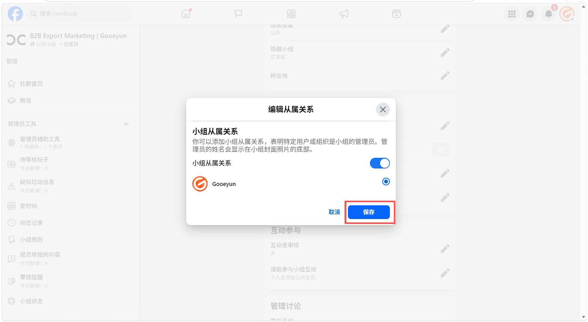
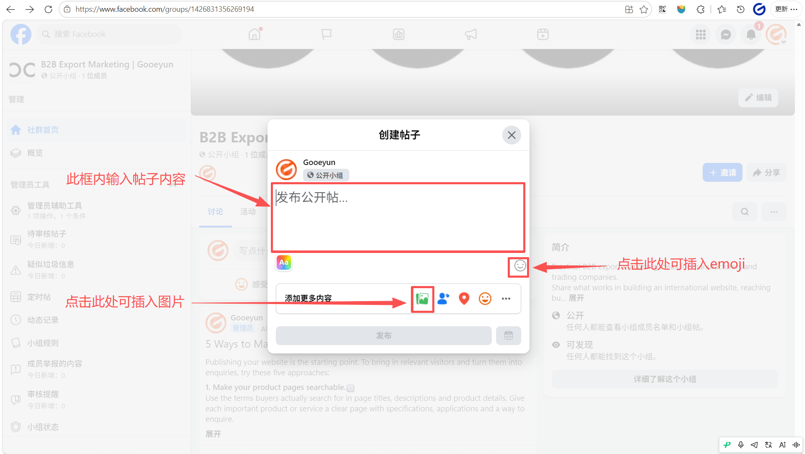

# 关联小组与公共主页
>**以公共主页身份进入小组**：确保您当前切换到了要关联的公共主页身份。
## 在左侧的 **管理工具** 菜单中，向下滚动并点击 “小组设置”

## 点击“小组从属关系”

## 点击“切换开关”，将小组从属关系状态切换为开启

## 选择您想要展示的 “公共主页”，然后点击“保存”

    
## 保存后显示公共主页名字则代表添加成功

# 修改小组的 URL 链接
## 点击“网址” 旁边的铅笔图标

## 在文本框中输入内容后，点击保存
**设置小组网址的建议**
- **使用英文和数字**：URL 只能包含英文字母和数字。如果小组名称是中文，您必须将其翻译或转写为英文。
- **保持简洁易记**：一个短的 URL 更方便您在公共主页贴文、业务邮件或 WhatsApp 中分享。
- **包含关键词**：建议使用“品牌名+产品词”或“行业词+Sourcing”的形式。
	- _示例_：如果小组名是“High-Quality LED Lighting Wholesale”，网址可以设为 `facebook.com/groups/LEDLightingWholesale` 或 `facebook.com/groups/GooeyunSourcing`。
- **唯一性**：如果该网址已被其他小组占用，您需要尝试添加数字或微调词汇。
**操作注意**
- 一旦您的小组人数超过 5,000 人，您将无法再次修改该网址。
- 修改后，旧的系统默认网址（带有一串长数字的那个）仍然有效，但新的自定义网址看起来会更专业。
## 当URL成功显现刚刚填入的文字时代表修改成功

# 撰写欢迎贴

### 打开您创建的小组页面，点击页面顶部的“写点什么...框”。

    

### 撰写欢迎贴内容
- 在框内输入帖子内容，emoji表情
- 点击下方的 **图片/视频** 图标，配上一张工厂团队的合影或生产线的高清照片，增加真实感。

**欢迎贴参考内容**：
**Headline**: Welcome to the [您的行业/产品关键词] Global Sourcing & Tech Hub!  

**Body**:  
Hi everyone! We are thrilled to have you here. This group is managed by **[您的公共主页名称]**, a professional factory based in China specializing in **[您的主营产品]**.

Our goal is to build a high-quality community for wholesalers, distributors, and sourcing agents to share industry insights and get direct factory support.

**What you can expect here**:  
 Daily industry news & market trends.  
 Direct technical support from our engineering team.  
 Exclusive wholesale price lists & new product launches.

**Group Rules**:  
 **No Spam**: Please do not post unrelated advertisements or repetitive links.  
 **Be Professional**: Keep discussions focused on business and technology.

**Action Call**:  
We’d love to know more about you! Please **introduce your business in the comments below**:
- What is your company name?
- Which products are you currently sourcing?
Let’s grow together! 

## 点击“发布”

## 点击贴文右上角的 **三个点 (...)** 图标。

## 在下拉菜单中选择 **标为精选**
>这条贴文就会始终显示在小组顶部的“精选”板块，确保每位新成员进群都能第一时间看到。

