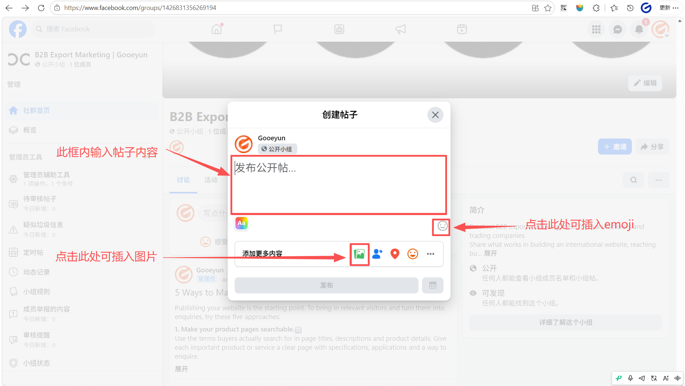
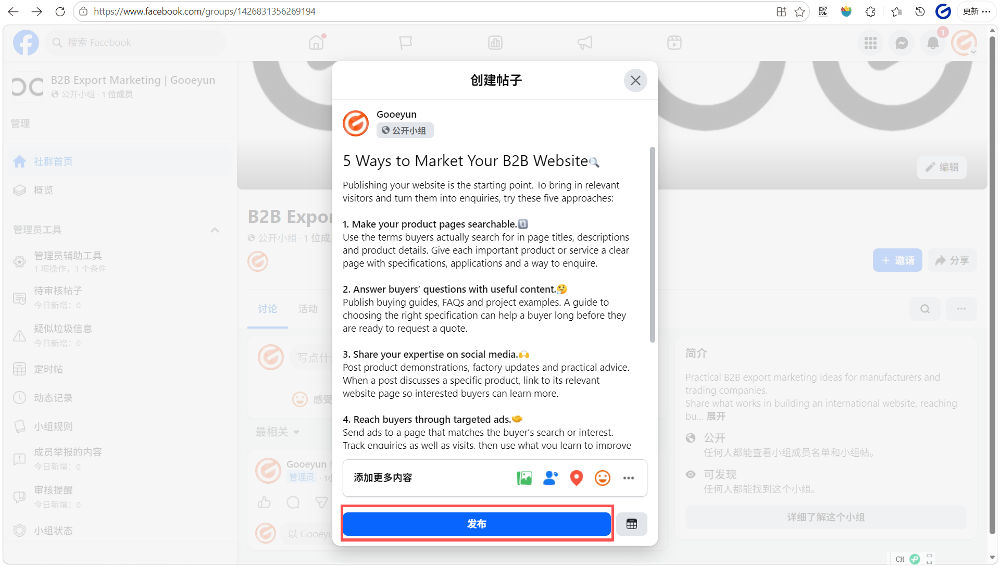

- **内容填充期（第1-2周）**：在邀请大规模成员前，先发布 5-10 条高质量的专业贴文，让进群的人觉得“有料可看”。
- **主动引流期（第3-4周）**：在您的公共主页贴文中分享社群链接，并在回复客户咨询时顺便邀请他们加入社群获取更多支持。
- **规则维护期（持续进行）**：严格审核入群申请，及时清理垃圾广告，确保社群始终保持专业的商务交流环境。
# 内容填充
您需要集中发布 5-10 条具有长久参考价值的贴文（如产品选型指南、工厂资质合集、核心技术解析），并将其分类或置顶，让小组看起来像一个行业知识库。
## 小组发帖的具体步骤
### 打开您创建的小组页面，点击页面顶部的“写点什么...框”。

    

### 撰写内容
- 在框内输入帖子内容，emoji表情
- 点击下方的 **图片/视频** 图标，上传您的高清产品图或工厂生产线视频。

### 确认无误后点击 “**发布**”

## **小组内容填充的 4 大核心板块**
- **权威背书类（必填）**：
	- 发布一条包含工厂全景视频、ISO 认证证书、核心专利和大型合作案例的贴文。
	- _目的_：消除新成员的信任顾虑。
- **专业指南类（价值核心）**：
	- 编写“XX 产品采购避坑指南”或“如何根据您的项目选择合适的规格”。
	- _目的_：展示专家身份，让买家觉得“进群能学到东西”。
- **资源下载类（吸引留存）**：
	- 上传最新的电子产品目录（E-catalog）或行业白皮书。
	- _目的_：提供即时的实用价值。
- **互动规则类（秩序建立）**：
	- 发布并置顶欢迎贴，明确告知成员如何提问、如何获取报价以及哪些行为会被禁言。

# 撰写欢迎贴
## 当有人正式加入您的小组后，点击“用户”

## 点击“写欢迎贴”

## 撰写好帖子内容后点击“发布”

### 参考欢迎贴
**Headline**: A warm welcome to our new members!  
**Body**:  
We are excited to have you join the **[您的行业/产品关键词] Global Sourcing Hub**. This community is managed by **[您的公共主页名称]**, and we are here to support your business with high-quality products and industry expertise.
@ [系统自动生成的成员名单]

**To get started, we recommend**:
- **Check the Featured Post**: Read our group rules and factory introduction to know how we can help you.
- **Introduce Yourself**: What is your company name and which products are you currently sourcing? Let us know in the comments!
- **Get Support**: Feel free to post your technical questions or sourcing requirements anytime.
Let’s build a successful business together! 
Our Team: [您的网址]
### 欢迎贴注意事项
- **频率控制**：不要每加入一个新成员就发一次帖，这样会造成刷屏并打扰老成员。建议**每周固定一天**（如每周五）集中欢迎本周加入的所有新成员。
- **引导“破冰”提问**：B2B 客户通常比较被动。在欢迎贴末尾一定要提一个具体的业务问题，例如 "What is your main business line?" 或 "Which product specifications are you most interested in?"，引导他们留下第一条评论。
- **关联置顶内容**：在欢迎贴中提醒新成员查看“精选（Featured）”板块。那里应该有您的工厂介绍、产品目录和小组规则，这能让他们迅速了解您的供应实力。
- **使用专业配图**：避免使用系统自带的简单背景。建议配上一张真实的工厂全景、先进的生产线或团队合影，增加真实感和信任背书。
- **语言地道简洁**：使用专业的商务英语，避免过长的段落。使用项目符号（Bullet points）让内容易于快速阅读。

# 开始引流（获取成员）
引流主要有两种方式，在此教程中主要介绍**公共主页引流**的操作
1. **公共主页引流**：在您的公共主页发布一条贴文，介绍新成立的小组并附上您刚刚定制的短网址。
2. **邀请老客户**：通过邮件或 WhatsApp 将网址发给合作过的买家，邀请他们作为“种子成员”加入。
## 公共主页引流
### 点击 Facebook 页面右上角头像，切换到您的 **公共主页** 身份。

### 点击“分享新鲜事”框

### 输入帖子内容，确认后点击“下一页”，然后发布

在公共主页发布引流贴时，内容应聚焦于**小组能为买家解决什么问题**。对于 B2B 业务，建议贴文包含：明确的痛点解决、进群福利、小组链接以及一张极具供应实力的配图
#### 推荐文案模板
**Headline**: Looking for a reliable [您的产品名] partner in China?  
**Body**:  
Tired of middleman markups and slow technical support? Join our **[小组名称]** to connect directly with our factory team!
**What’s inside for you**:  
 Real-time factory production updates.  
 Direct technical consultation from our engineers.  
 Exclusive wholesale price lists & E-catalogs.

Join our professional community today:  
 [您的社群链接]

Let’s streamline your sourcing process together! 

### 发布后，点击贴文右上角的 三个点 ，选择 “置顶贴文”，让它始终显示在主页最上方。

