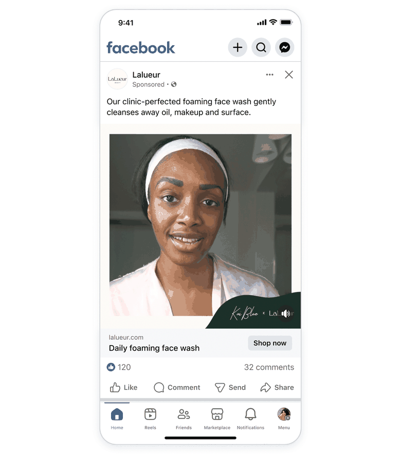
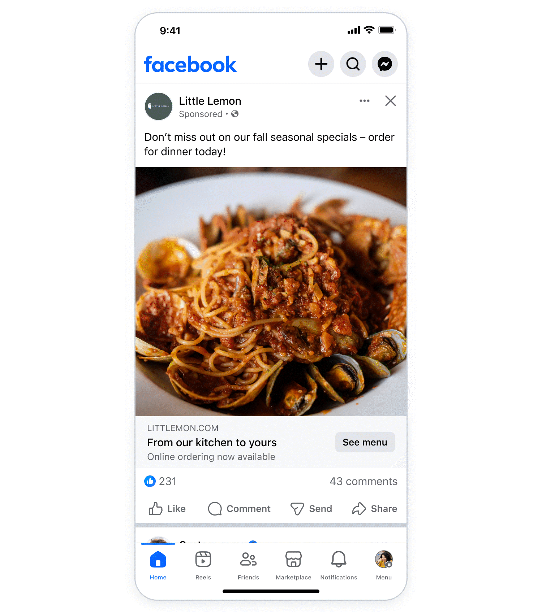
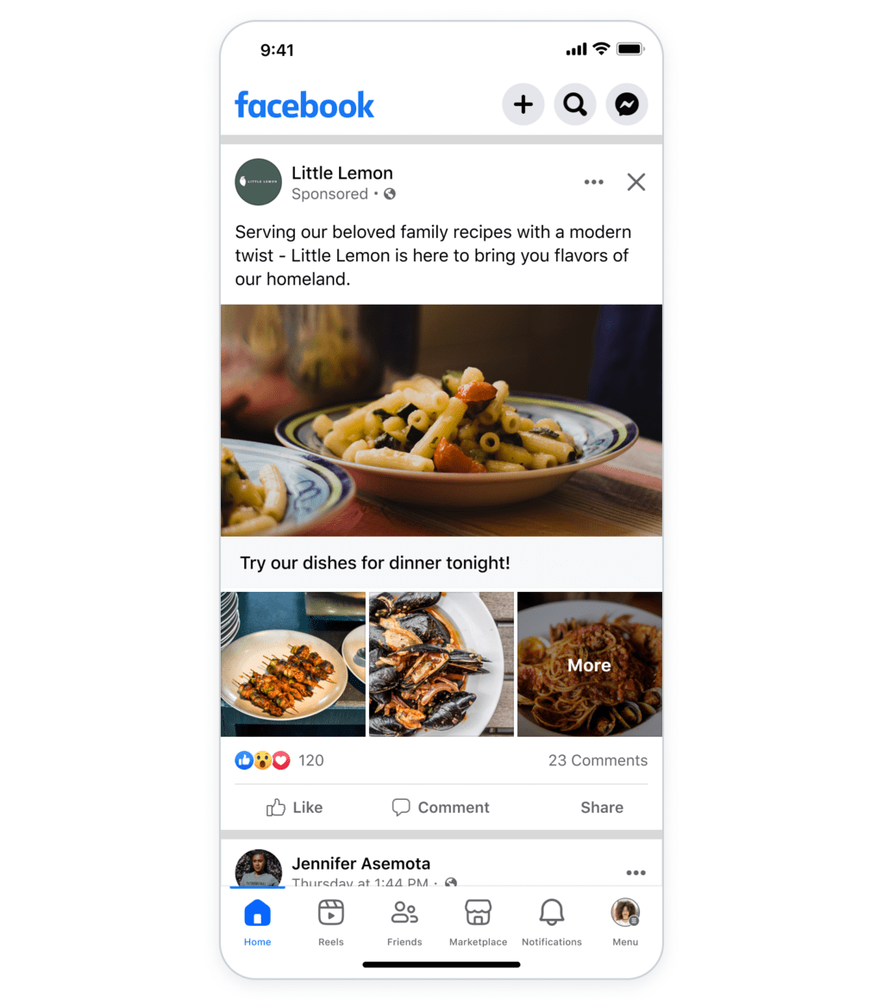
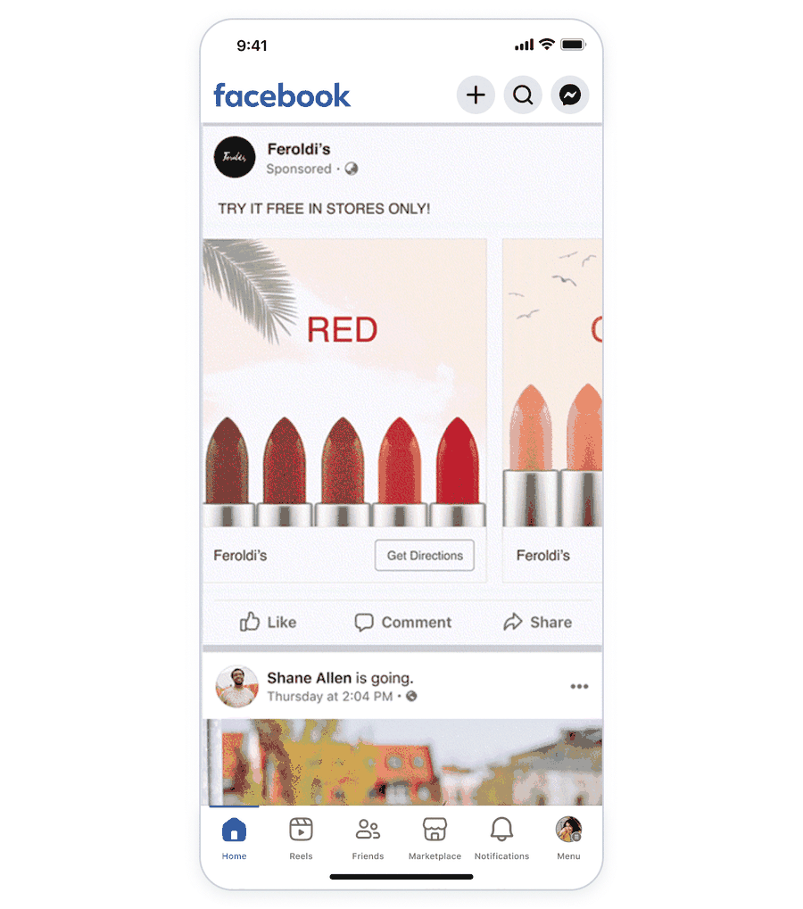

# 六大广告格式

| 类型                                                                                                                                                                          | 示例                                   |
| --------------------------------------------------------------------------------------------------------------------------------------------------------------------------- | ------------------------------------ |
| **单图片广告【B2B】** 所有广告目标均支持使用单图片广告 (Single Image Ad) 格式。 推荐的文案长度为**正文栏位 125 个字符，标题栏位 40 个字符，描述栏位 25 个字符**。不过，您的文案在不同的版位和设备上可能会被截断。尽量让文本简短有力，以减少被截断的情况。                   |  |
| **视频广告【B2B】** 所有广告目标均支持使用视频广告。创作时长不超过 **15 秒**的视频，以吸引受众关注和持续互动。                                                                                                          |                    |
| **幻灯片** 可结合使用多个图片素材、文本和声音。 所有广告目标均支持使用幻灯片 **幻灯片广告加载更快、显示更流畅，更适合触达网络差的地区(印度、东南亚、非洲等新兴市场)**                                                                          |                       |
| **精品栏广告【零售】** 您可将图片和视频加以结合，从而提升发现率和销量。您可以向受众展示多达 50 款商品，吸引他们浏览和购买。用户点击或轻触广告后，即可进入全屏模式查看更多商品。                                                                             |                |
| **即时体验【零售】** 用户在点击或轻触广告后跳转至**落地页** 这类广告的加载速度比标准移动网页更快。用户可以查看视频和照片、滑动浏览轮播图片、填写表单、快速查看商品，还可以探索包含标记商品的生活类图片。 Meta 即时体验的落地页是点广告后在 Facebook/Instagram 应用内秒开的全屏页面，不跳出应用。 |           |
| **轮播【B2B】** 单条轮播广告 (Carousel Ad) 中能展示多达 10 个可点击的图片和视频素材。您可以**优先展示表现最佳的图卡**。任何广告目标都支持所有这些广告格式。                                                                            |                     |
# 版位与尺寸规范
## meta广告版位类型
- Facebook 版位包括：
	- 动态
	- 快拍
	- Reels
	- 搜索结果
	- 发现 Facebook 商家
	- 视频动态
	- 视频插播位
	- Marketplace
	- 右边栏
- Instagram 版位包括：
	- 动态
	- 快拍
	- Reels
	- 搜索结果
	- Instagram 发现
- Messenger 版位包括：
	- 收件箱
	- 快拍

## 各版位广告的尺寸与视频市场
### 尺寸、格式与用户行为习惯
用户在不同版位的行为习惯也存在差异。在 Instagram，用户可能更喜欢与富有视觉吸引力的内容互动，而在 Facebook，用户可能对文字占比较多的广告更感兴趣。用户在不同版位的注意力持续时间也不同。在 Instagram 快拍，用户通常只花几秒钟的时间来浏览广告。而在 Facebook，他们则可能会投入更多的时间。
**1. Facebook 动态 (Facebook Feed)**
- **素材尺寸与宽高比**：最通用的是 1080 x 1080 像素，宽高比 1:1。也支持 1080 x 1350 像素，宽高比 4:5，竖版在手机上占据更多屏幕，效果更好。横版 1.91:1 也支持，但展示面积较小。
- **支持格式**：单图、单视频、轮播都支持。视频建议时长 15秒以内，自动静音播放，需要加字幕。
- **用户行为习惯**：用户是上下滑动浏览，停留时间短，习惯看标题、正文和评论。互动方式是点赞、评论、分享和点击链接，适合用清晰的产品图 + 强有力的标题来吸引点击。
**2. Instagram 快拍 (Instagram Stories)**
- **素材尺寸与宽高比**：必须是全屏竖版 1080 x 1920 像素，宽高比 9:16。如果用 1:1 的图，上下会留出大面积空白，体验很差。
- **支持格式**：单图 5秒、单视频最长 60秒。顶部和底部约 250像素是安全区，要避开头像、回复框，不要把重要文字和按钮放在那里，否则会被遮挡。
- **用户行为习惯**：用户是点击/轻扫切换，沉浸式全屏观看，节奏非常快。互动方式是向上滑动、点击贴纸、投票、问答和“发消息”按钮，更偏向轻松、原生、互动性强的内容，不适合放太多文字。

### 视频制作建议
- 积极利用视频
	- 结合使用多种格式的广告创意（例如结合使用静图和视频）
	- 视频要尽可能简短，同时又能完整叙事。用户更有可能完整观看长度在 15 秒内的视频广告
	- 对于长度无法缩短至 15 秒内的视频，可考虑使用视频插播位。有声播放的视频插播广告 (In-Stream Video Ad) 能吸引用户长时间观看，最适合用于传递更为复杂的营销信息。详细了解[视频插播广告](https://www.facebook.com/business/help/902459833240201?id=241532349736982)。
- 品牌元素
	- 在视频开头 3 秒内醒目展示品牌、徽标或商品，并在视频结尾再次展示上述元素。
	- 在整个视频中使用具有品牌特色的色彩、主题和图像。
	- 包含更具吸睛效果的动态图片。
- 文案
	- 务必要告诉用户，在看到您的广告后应采取什么操作，这一点很重要。所有文案都应该契合此目标。措辞简洁，对于大多数版位，推荐的文案长度为**正文字段 125 个字符，标题字段 40 个字符，描述字段 25 个字符。**
- 图片
	- 使用高清图片，避免使用过度精修的图片。
	- 展示品牌或徽标。
	- 展示人们是如何使用您的商品或服务的，这有助于受众将自己代入其中，想象使用场景。
	- 裁剪图片，展示关键部分。若想在同一条广告中展示多张图片，可使用轮播格式。
- 声音与字幕
	- 在设计移动视频广告时，应确保其在有声和静音播放时都能取得良好的效果。
	- 添加说明文字或字幕。
	- 以创意方式展示徽标和带有品牌标识的商品照片，帮助宣传品牌。
	- 确保视觉素材能吸引眼球，即使没有声音也易于理解。

# 行动号召按钮

| **目标**                                       | **按钮**   |
| -------------------------------------------- | -------- |
| 方便用户预订旅游产品或预约服务。                             | 立即预约     |
| 方便用户向餐厅订餐。                                   | 立即订餐     |
| 让用户轻轻一点即可致电商家。                               | 立即拨打     |
| **引导用户在网站上填写表单，让您能挖掘更多潜在客户。**                | **联系我们** |
| **方便用户通过 Facebook 向商家发送消息。**                 | **发消息**  |
| 引导用户在网站上填写表单，让您能挖掘更多潜在客户和订阅用户。               | 立即注册     |
| **引导用户在商家的 Facebook 公共主页上填写表单，以请求获取更多业务资讯。** | **立即询价** |
| 鼓励用户在 Facebook 公共主页或网站上观看视频。                 | 更多视频     |
| **引导用户前往目标位置，找到商家及其提供的商品或服务的更多信息。**          | **详细了解** |
| 吸引更多用户前往商家的网站或 Facebook 公共主页浏览和购买商品。         | 去逛逛      |
| 吸引更多用户前往商家的 Facebook 公共主页查看和领取优惠。            | 领取优惠     |
| 引导用户前往应用，助您提升下载量或使用率。                        | 使用应用     |
| 鼓励用户下载或玩游戏。                                  | 玩游戏      |
# 广告文案技巧

## 广告的文本部分

## 撰写广告文案技巧
- 讲述品牌故事：通过添加广告文案来讲述您的品牌故事，重点宣传品牌的独特之处。故事营销是与受众交流互动最有效的方式之一。
- 使用话题标签：在广告中使用话题标签、地点标签和提及他人来提升覆盖人数。确保您仅使用与广告相关的特定话题标签，并避免在内容中填充过多的话题标签。
- 直接与受众交流：撰写广告文案时要考虑到受众，最好像是在直接与他们对话一样。
- 保持风格统一：在每条广告中都使用相同的语气，这样无论受众在何处看到您的广告，都能轻松认出您的品牌。同时，请确保措辞简单明了。
- 制造紧迫感：使用诸如以下的词语：立即、现在、仅限本周！  加上时间限制有助于激发受众行动力
